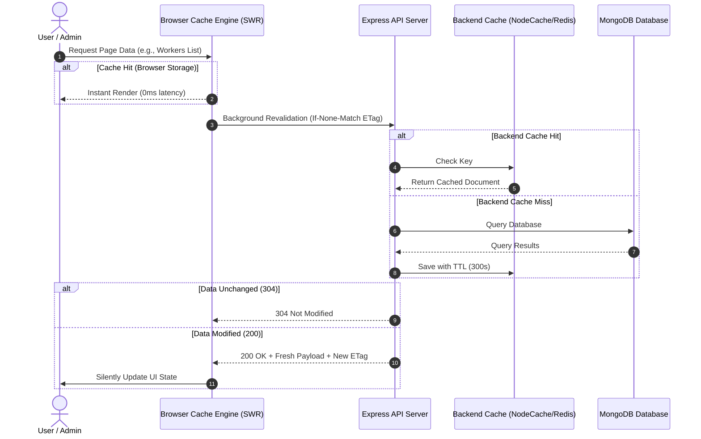

# KaamSetu - Industrial Architecture & System Design Specification

## 1. Executive Summary
**KaamSetu** is an on-demand blue-collar trade worker discovery and workforce management platform designed specifically for India's service ecosystem (Electricians, Plumbers, Welders, Carpenters, Painters, Masons, etc.). The system operates with zero-commission, direct worker contact, location-proximity dispatch, customer booking records, and an enterprise administrative audit ledger.

---

## 2. High-Level Architecture (C4 Container View)

```mermaid
graph TD
    ClientBrowser[Desktop & Mobile Browsers] -->|HTTPS:443| NginxProxy[Nginx Enterprise Reverse Proxy]
    
    subgraph Frontend Tier
        NginxProxy -->|/| ReactFrontend[Customer & Worker Web App (Vite + React)]
        NginxProxy -->|/admin| ReactAdmin[Enterprise Admin Control Center (Vite + React)]
    end

    subgraph API & Gateway Tier
        NginxProxy -->|/api| ExpressAPI[Node.js / Express API Cluster]
        ExpressAPI --> HelmetRateLimit[Helmet Security & Rate Limiting]
        ExpressAPI --> CookieParser[HTTP-only Secure Cookie Session Engine]
        ExpressAPI --> CacheLayer[In-Memory / Redis Caching Layer]
    end

    subgraph Data & Storage Tier
        ExpressAPI -->|Mongoose ODM| MongoDB[(MongoDB Replica Set / Atlas)]
        ExpressAPI -->|Dynamic Cache| MemoryCache[(Fast Cache Storage)]
    end
```

---

## 3. Core System Components

### 3.1 Nginx Reverse Proxy & Edge Layer
- **Unified Domain Routing**: Routes `/` to the public customer application, `/admin` to the admin control center, and `/api` to the REST backend.
- **Performance & Compression**: Native Brotli & Gzip compression for static JS/CSS bundles and JSON payloads.
- **Security Hardening**: Enforces Content Security Policy (CSP), X-Frame-Options, HSTS, and request size limiting.

### 3.2 Backend Service (Node.js & Express)
- **Layered Architecture**: Decoupled into `controllers/`, `services/`, `models/`, `routes/`, `middleware/`, and `validators/`.
- **Dual Authentication**:
  - **HTTP-Only Cookies (`kaamsetu_session`)**: Primary web session carrier, protected against XSS.
  - **Bearer JWT Tokens**: Secondary carrier for mobile app clients and headless API consumers.
- **Multi-Tier Caching**:
  - In-memory NodeCache / Redis for hot read queries (categories, verified worker directories, aggregated admin statistics).
  - Client-side Stale-While-Revalidate (SWR) cache engine for near 0ms load times.

### 3.3 Database Tier (MongoDB)
- **Indexes**: Compound geospatial and search indexes on `city`, `category`, `isVerified`, `isAvailable`, `rating`, and `phone`.
- **Integrity**: Referential integrity for customer bookings, worker associations, and review histories.

---

## 4. Multi-Tier Caching & Performance Strategy



---

## 5. Security & Session Model
1. **HTTP-only Cookies**: Cookies are set with `HttpOnly=true`, `SameSite=Lax`, and `Secure=true` in production to eliminate credential theft via XSS.
2. **Anti-Brute Force Protection**: Dedicated rate limiter restricting login attempts to a maximum of 15 requests per 15 minutes per IP.
3. **NoSQL Injection Sanitization**: Input sanitization strips out `$` and `.` operators from client inputs.
4. **CORS Hardening**: Strict origin whitelisting with `credentials: true`.
